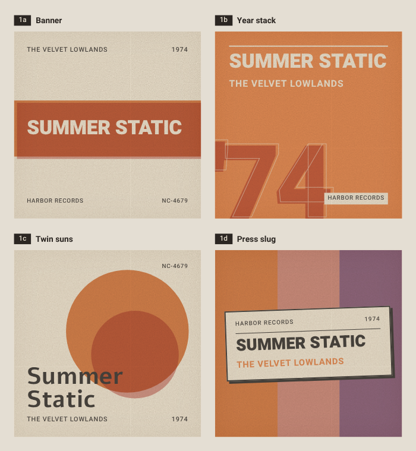

# cover-forge

Deterministic, print-style **placeholder album covers** generated from metadata — for music
libraries where some albums have no artwork. Give it `artist`, `title`, `year`, `label`, get a
square PNG that looks like a faded 1970s record sleeve. The same metadata always yields the same
cover; different albums get distinct colours and one of four layouts.



| | layout | |
|---|---|---|
| **1a** | Banner | title on a two-ink offset band, artist/year header, label/catalogue footer |
| **1b** | Year stack | big two-digit year with a stroked ghost copy, title stack on the ink ground |
| **1c** | Twin suns | two overlapping multiply-blended discs, serif-slot title, mono meta row |
| **1d** | Press slug | three ink stripes with a rotated, hard-shadowed paper slug |

Every cover gets a paper tone, a grain overlay (SVG turbulence, multiply) and a paper fade, so the
placeholders sit comfortably next to scanned real sleeves.

## How a cover is chosen

`FNV-1a(artist + "|" + title) + seed * 7919` drives everything, so the result is stable across runs
and machines:

* three inks from an 8-colour faded palette (`ink1/ink2/ink3`, always distinct), one of 4 paper tones
* a catalogue number `NC-1000..NC-9999` unless you pass `cat=`
* title size by length (<= 8, <= 16, longer); the renderer only shrinks further if the title would
  overflow its box (long titles, tall Hebrew glyphs) — never clips
* the layout (`1a`..`1d`) unless you pass `layout=`
* `seed=N` reshuffles all of the above (the design's "seed shift")

Rendering is done by headless Chromium from the design's own HTML/CSS (blend modes, `text-wrap:
balance`, grain), screenshotted at `size / 320` device pixels per CSS pixel.

### Hebrew / RTL

Every text node carries `dir="auto"`, so Hebrew (or Arabic) titles and artists run right-to-left and
align to the right edge of their box while the layout itself stays as designed. The bundled fonts cover
Hebrew and Latin; Noto Sans is the fallback for other scripts.

## Fonts

Bundled in the image at build time (no network font loading at runtime), all SIL OFL 1.1 — licence
texts in [`fonts/`](fonts/), credits in [`NOTICE`](NOTICE):

* **Heebo** (variable 100–900) — all sans text: display titles at 900, labels at 500/700
* **Alef** (Regular/Bold) — the "serif" slot used by the Twin suns title
* **Noto Sans** (Debian `fonts-noto-core`) — glyph fallback

## Run

```bash
cp .env.example .env            # optional: TOKEN, PUID/PGID, HOST_DATA_DIR, Jellyfin settings
mkdir -p data                   # cache + ledger (bind-mounted as /data; or the dir HOST_DATA_DIR points at)
docker compose up -d --build    # publishes 127.0.0.1:8793
curl -o cover.png 'http://127.0.0.1:8793/cover.png?artist=The+Velvet+Lowlands&title=Summer+Static&year=1974&label=Harbor+Records'
```

Or without compose:

```bash
docker build -t cover-forge .
docker run -d --name cover-forge -p 127.0.0.1:8793:8793 -v "$PWD/data:/data" --user "$(id -u):$(id -g)" --shm-size 256m cover-forge
```

The container runs as the uid you give it (`PUID`/`PGID` in `.env`, default 1000) so it can write to
the bind-mounted data dir (`HOST_DATA_DIR` in `.env`, default `./data`; keep it in your backups if you use
the Jellyfin backfill — `ledger.json` is what protects real covers). Memory: ~100 MB idle, ~350–420 MB after large renders (compose caps it at
512 MB). A warm 1000 px render takes ~150 ms, a 2000 px one ~400 ms; cache hits are served from disk.

## API

| endpoint | returns |
|---|---|
| `GET /cover.png?artist=&title=&year=&label=&cat=&layout=1a\|1b\|1c\|1d&seed=0&size=1000&grain=1&fade=0.14` | square PNG, `size` 64..2000 (default 1000) |
| `GET /cover.jpg?<same params>` (or `/cover.png?…&format=jpeg`) | the same cover as a JPEG (quality `JPEG_QUALITY`, default 90) |
| `GET /sheet.png?<same params>` | 2x2 contact sheet of all four layouts (width = `size`, height = size × 1.084) |
| `GET /healthz` | `{"ok":true,"renders":…,"cacheHits":…,"avgMs":…,"rssMb":…}` |

* All metadata parameters are optional; an empty title renders as "Untitled".
* `grain=0` switches the grain off, `fade=0..0.5` sets the paper fade (design default 0.14).
* Response headers `x-cover-layout`, `x-cover-ink`, `x-cover-cat` tell you what the hash picked.
* Results are cached on disk under `/data/cache` keyed by a hash of the normalised parameters;
  responses carry an `ETag` and a long `Cache-Control`.
* If `TOKEN` is set, requests need `Authorization: Bearer <TOKEN>` (or `?token=`); `/healthz` stays open.
  Unset = open, intended for loopback-only publishing.

## Jellyfin backfill

`bin/backfill-jellyfin.mjs` gives every music album (and, with `--artists`, every artist) that has
**no primary image** a generated cover, and remembers what it uploaded so it never overwrites a real
cover that shows up later.

```bash
# .env: JELLYFIN_URL, JELLYFIN_API_KEY, optional JELLYFIN_USER_ID
docker compose exec cover-forge node bin/backfill-jellyfin.mjs --dry-run --limit 10   # default mode
docker compose exec cover-forge node bin/backfill-jellyfin.mjs --apply
```

| flag | |
|---|---|
| `--dry-run` (default) | print the plan, write the PNGs to `--out` (default `backfill-out/`), upload nothing |
| `--apply` | upload via `POST /Items/{id}/Images/Primary` |
| `--limit N` | stop after N items |
| `--refresh` | re-render ledger items whose metadata changed (add `--force` for all of ours); an item that now has a *different* primary image than the one we uploaded is left alone |
| `--artists` | include `MusicArtist` items (title = artist name) |
| `--size N`, `--seed N` | passed through to the renderer |
| `--ledger PATH` | default `/data/ledger.json` — `{items: {<itemId>: {hash, layout, jfTag, uploadedAt}}}` |
| `--revert` | undo: `DELETE` the primary image of every ledger entry whose current image is still ours (dry-run unless `--apply`); real covers that replaced ours are kept |

Items that already have a primary image are never touched. Cover metadata: album artist, album
name, `ProductionYear`, first studio as the label. Folder-derived names are cleaned first
(`lib/normalize.js`): a leading `(1968) ` / `[1968] ` / `1968 - ` or trailing ` (1968)` is stripped when
it matches the album's year (or adopted as the year if the album has none), and a disc/track-style
`2 - ` / `1. ` prefix is dropped; every change is logged `before → after`. The renderer itself stays literal. Run it from cron / a systemd timer after Jellyfin's
own "download missing images" task, so real artwork wins.

## Folder backfill (folder.jpg)

`bin/backfill-folder.mjs` writes the **same** placeholder (same hash, seed and layout as the Jellyfin upload) as
`folder.jpg` into the album folder on disk for every album in the Jellyfin backfill ledger, so file-based players
(e.g. a music server that reads `folder.*` / `cover.*`) show identical art. Details: [`docs/COVER-FORGE.md`](docs/COVER-FORGE.md).

```bash
# .env: MUSIC_DIR (host music tree, mounted rw at /music), JELLYFIN_MUSIC_PREFIX (the tree as Jellyfin sees it)
docker compose exec cover-forge node bin/backfill-folder.mjs --dry-run --limit 10   # default; JPEGs go to /data/backfill-folder-dry/
docker compose exec cover-forge node bin/backfill-folder.mjs --apply
```

| flag | |
|---|---|
| `--dry-run` (default) | print the plan (planned / skipped-existing-cover / skipped-in-ledger / unmapped-path / missing-dir) and write the JPEGs to `--out` (default `/data/backfill-folder-dry/`), nothing into the music tree |
| `--apply` | write `folder.jpg` (1000 px, JPEG q90) into each album folder; folders with any `folder.*`/`cover.*`/`front.*`/`album.*` image are skipped |
| `--refresh` | rewrite ledger items, but only where `folder.jpg` is still byte-identical to what we wrote |
| `--revert [--apply]` | delete our `folder.jpg` files where the sha256 still matches the ledger; changed files are kept |
| `--limit N`, `--size N`, `--seed N` | as for the Jellyfin backfill |
| `--ledger PATH` | default `/data/ledger-folder.json` (`LEDGER_FOLDER`) — `{items: {<itemId>: {path, sha256, hash, layout, writtenAt}}}` |

## Development

```bash
docker compose run --rm cover-forge npm test     # renders Latin + Hebrew covers per layout, checks PNG sizes
```

`lib/design.js` is the whole visual spec (hash, palettes, templates); `server.js` is the renderer
(page pool, cache, HTTP). The templates are plain HTML strings at the design's native 320×320 px.

## Credits

* Layouts, palette and print treatment: designed in **Claude Design** ("Album Cover Placeholder") and
  ported 1:1 to `lib/design.js`.
* Fonts: Heebo (Oded Ezer et al.), Alef (HaGilda & Mushon Zer-Aviv), Noto — SIL Open Font License 1.1.

## License

MIT — see [LICENSE](LICENSE). Font licences: [`fonts/OFL-Heebo.txt`](fonts/OFL-Heebo.txt),
[`fonts/OFL-Alef.txt`](fonts/OFL-Alef.txt).
